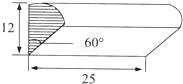

# Mathematics (Grade 6)

**ID**: 97a12430
**难度**: medium_hard
**题型**: short_answer

## 题目
如图是一个横截面为扇形的机器零件(单位：厘米)，求它的体积．

## 解答

**答案**: 1884

1. Step1:根据扇形面积公式，已知扇形半径为12厘米，角度为60°，计算底面扇形面积，即3.14×12²×60÷360
2. Step2:化简上一步式子，3.14×144×1/6
3. Step3:计算出底面扇形面积为3.14×24
4. Step4:已知零件的高为25厘米，根据体积=底面积×高，计算零件体积为3.14×24×25
5. Step5:计算3.14×24×25的结果为3.14×600
6. Step6:最终得出零件体积为1884立方厘米

## 知识点

**知识点**:
  - 规则立体图形的体积．

---
