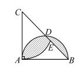

# Mathematics (Grade 6)

**ID**: 98088f02
**难度**: medium_hard
**题型**: short_answer

## 题目
如图，直角三角形ABC中，AB长10厘米，∠C=45°，求图中阴影部分的面积。

## 解答

**答案**: 28.5

1. Step1:先计算半圆的面积，半圆半径为AB的一半，即10÷2 = 5厘米，根据圆的面积公式S = πr²，可得半圆面积为3.14×(10÷2)²÷2 = 3.14×25÷2 = 39.25平方厘米
2. Step2:再计算三角形ABC的面积，根据三角形面积公式S = 底×高÷2，AB为底和高，所以三角形ABC面积为10×10÷2 = 50平方厘米
3. Step3:接着计算扇形ACE的面积，已知∠C = 45°，半径为10厘米，根据扇形面积公式S = n×π×r²÷360（n为圆心角度数），可得扇形ACE面积为45×3.14×10²÷360 = 314÷8 = 39.25平方厘米
4. Step4:最后根据阴影部分的面积等于半圆的面积加上扇形ACE的面积减去三角形CAB的面积，可得阴影部分面积为39.25 + 39.25 - 50 = 28.5平方厘米

## 知识点

**知识点**:
  - 组合图形的面积;圆的面积;三角形的面积;扇形的面积

---
