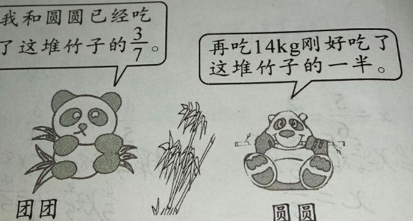

# Mathematics (Grade 6)

**ID**: 987b99c7
**难度**: medium_hard
**题型**: short_answer

## 题目
熊猫馆运回的这堆竹子共有多少千克？

 团团   圆圆
 我和圆圆已经吃了这堆竹子的
 $\frac{3}{7}$
  ，再吃14kg刚好吃了这堆竹子的一半.

## 解答

**答案**: 196

1. Step1:明确竹子总量为单位'1'，已知已经吃了这堆竹子的$rac{3}{7}$，再吃14kg就达到这堆竹子的$rac{1}{2}$
2. Step2:计算14kg竹子对应的占比，用$rac{1}{2}$减去$rac{3}{7}$，即$rac{1}{2} - rac{3}{7} = rac{7}{14} - rac{6}{14} = rac{1}{14}$
3. Step3:因为14kg竹子占总量的$rac{1}{14}$，求竹子总量，用14除以$rac{1}{14}$，即$14\divrac{1}{14}=14	imes14 = 196$千克

## 知识点

**知识点**:
  - --

---
