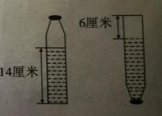

# Mathematics (Grade 6)

**ID**: 99b8fe4c
**难度**: medium_hard
**题型**: short_answer

## 题目
有一种饮料瓶的瓶身呈圆柱形（不包括瓶颈），容积是3升。现在瓶中装有一些饮料，正放时饮料高度为14厘米，倒放时空余部分的高度为6厘米（见下图）。瓶内现有饮料多少升？

 14厘米  6厘米

## 解答

**答案**: 2.1

1. Step1:将正放时饮料高度14厘米换算为1.4分米，倒放时空余部分高度6厘米换算为0.6分米
2. Step2:根据饮料瓶容积是3升，以及正放饮料高度和倒放空余部分高度，用容积除以两者高度之和得到圆柱的底面积，即3÷(1.4 + 0.6)
3. Step3:再根据圆柱体积公式v = sh，用得到的底面积乘以正放时饮料的高度1.4分米，即3÷(1.4 + 0.6)×1.4，得出瓶内现有饮料的体积为2.1升

## 知识点

**知识点**:
  - 

---
