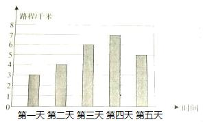

# Mathematics (Grade 6)

**ID**: 9b0eb4fc
**难度**: medium_hard
**题型**: short_answer

## 题目
小明每天早晨起来跑步，并记录了每天所跑的路程，如图。
（1）他哪天跑得最多？哪天跑的最少？
（2）他五天一共跑了多少千米？平均每天跑几千米？

## 解答

**答案**: 第4天, 第1天, 25千米, 5千米

1. Step1:观察条形统计图，比较每天所跑路程的长短，确定跑的最多和最少的日期，得出第4天跑的最多，第1天跑的最少
2. Step2:将五天所跑路程相加，即3+4+6+7+5，计算得出五天一共跑的路程为25千米
3. Step3:用五天跑的总路程25千米除以天数5，计算得出平均每天跑的路程为5千米

## 知识点

**知识点**:
  - 小学数学;统计和概率;统计;统计图;简单条形统计图;统计图表的综合应用

---
