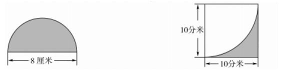

# Mathematics (Grade 6)

**ID**: 9ca05a48
**难度**: medium_hard
**题型**: short_answer

## 题目
按要求计算。

求阴影部分的周长：                                                           求阴影部分的面积：

## 解答

**答案**: 20.56, 21.5

1. Step1:计算阴影部分周长时，先求出直径8cm的圆的周长的一半，根据圆的周长公式C = πd（d为直径），那么圆周长的一半为3.14×8÷2
2. Step2:将圆周长的一半3.14×8÷2的结果加上直径8，即3.14×8÷2 + 8，计算得出20.56cm
3. Step3:计算阴影部分面积时，先求出边长为10dm的正方形的面积，根据正方形面积公式S = a×a（a为边长），即10×10
4. Step4:再求出半径10dm的圆的面积的1/4，根据圆的面积公式S = πr²（r为半径），那么圆面积的1/4为10×10×3.14×1/4
5. Step5:用正方形面积10×10减去圆面积的1/4 10×10×3.14×1/4，即10×10 - 10×10×3.14×1/4，计算得出21.5dm²

## 知识点

**知识点**:
  - 组合图形的面积;周长的认识

---
