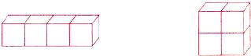

# Mathematics (Grade 6)

**ID**: 9de2c725
**难度**: medium_hard
**题型**: short_answer

## 题目
小东用4块正方体积木搭成如下的立体图形：

哪个立体图形的体积大？表面积哪个大？为什么？     

## 解答

**答案**: 用4块正方体搭成这两个立体图形，它们的体积一样大．, 搭成图1的表面积大．

1. Step1:因为两个立体图形都是由4块相同的正方体积木搭成，所以它们的体积都等于4块正方体积木的体积之和，因此它们的体积一样大
2. Step2:观察图1，4块正方体排成一排，相邻正方体有面重合，经分析可知有6个面重合，也就是图1长方体的表面积比4个正方体的表面积和减少了6个面的面积
3. Step3:观察图2，搭成一层两块两层的形状，经分析可知有8个面重合，也就是图2长方体的表面积比4个正方体的表面积和减少了8个面的面积
4. Step4:由于4个正方体的表面积和是固定的，图1减少的面的数量少，图2减少的面的数量多，所以搭成图1的表面积大

## 知识点

**知识点**:
  - 长方体和正方体的体积;长方体和正方体的表面积．

---
