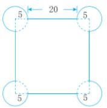

# Mathematics (Grade 6)

**ID**: 9e704a27
**难度**: medium_hard
**题型**: short_answer

## 题目
下图是一个花台的平面图，5为圆的半径（单位：m）。求这个花台的周长。

## 解答

**答案**: 174.2

1. Step1:分析图形可知，花台的周长由四条20m长的边长、4个圆的周长减去1个圆的周长组成
2. Step2:根据圆的周长公式C = 2πr（其中r为半径，π取3.14），一个圆的周长为2×3.14×5
3. Step3:4个圆的周长为2×3.14×5×4
4. Step4:四条20m长的边长总和为20×4
5. Step5:用四条20m长的边长总和加上4个圆的周长再减去1个圆的周长，即20×4 + 2×3.14×5×4 - 2×3.14×5
6. Step6:计算20×4 + 2×3.14×5×4 - 2×3.14×5 = 80 + 125.6 - 31.4 = 174.2（m）

## 知识点

**知识点**:
  - 圆的周长

---
