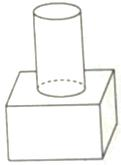

# Mathematics (Grade 6)

**ID**: a0d6b8bf
**难度**: medium_hard
**题型**: short_answer

## 题目
一个零件由一个圆柱体和一个长方体底座组成（如图）长方体的长、宽、高分别是5cm、4cm和3cm；圆柱的高是4.5cm，底面直径是2.4cm。如果要给这个零件表面涂上油漆，油漆面积是多少平方厘米？

## 解答

**答案**: 127.912

1. Step1:根据长方体表面积公式S=(ab + ah + bh)×2（其中a为长，b为宽，h为高），计算长方体表面积，a = 5cm，b = 4cm，h = 3cm，即(5×4 + 5×3 + 4×3)×2=(20 + 15 + 12)×2=47×2 = 94平方厘米
2. Step2:根据圆柱侧面积公式S = πdh（其中d为底面直径，h为高），计算圆柱侧面积，d = 2.4cm，h = 4.5cm，即3.14×2.4×4.5 = 33.912平方厘米
3. Step3:因为零件涂漆面积等于长方体表面积与圆柱侧面积之和，所以将两者相加，94 + 33.912 = 127.912平方厘米
4. Step4:将结果转化为列表形式['127.912']

## 知识点

**知识点**:
  - 小学数学;数与代数;应用题;面积、体积相关应用题

---
