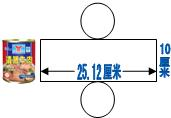

# Mathematics (Grade 6)

**ID**: a1134cff
**难度**: medium_hard
**题型**: short_answer

## 题目
图是一个圆柱体“牛肉罐头”的表面展开图．请你算一算，这个圆柱体“牛肉罐头”的容积是多少？（铁皮的厚度忽略不计）

## 解答

**答案**: 502.4立方厘米

1. Step1:根据图形可知圆柱底面周长为25.12厘米，高为10厘米
2. Step2:由圆的周长公式C = 2πr（C为周长，r为半径），可得底面半径r = 25.12÷3.14÷2 = 4厘米
3. Step3:根据圆的面积公式S = πr²，可得圆柱底面积为3.14×4²平方厘米
4. Step4:由圆柱容积公式V = Sh（V为容积，S为底面积，h为高），可得圆柱容积为3.14×4²×10 = 502.4立方厘米

## 知识点

**知识点**:
  - 小学数学;图形与几何;立体图形;圆柱和圆锥;圆柱的展开图;圆柱的体积

---
