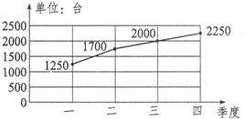

# Mathematics (Grade 6)

**ID**: a114a07c
**难度**: medium_hard
**题型**: short_answer

## 题目
某机床厂2006年机床产量统计图如下：
(1)平均每月生产机床多少台？
(2)第四季度比第一季度增产百分之几？
(3)第二季度比第三季度少百分之几？

## 解答

**答案**: 600, 80%, 15%

1. Step1:先计算2006年全年机床总产量，即1250 + 1700 + 2000 + 2250 = 7200台
2. Step2:再计算平均每月产量，7200÷12 = 600台
3. Step3:计算第四季度比第一季度增产的产量，2250 - 1250 = 1000台
4. Step4:计算第四季度比第一季度增产的百分比，1000÷1250 = 80%
5. Step5:计算第二季度比第三季度少的产量，2000 - 1700 = 300台
6. Step6:计算第二季度比第三季度少的百分比，300÷2000 = 15%

## 知识点

**知识点**:
  - 单式折线统计图;百分数的实际应用;从统计图表中获取信息．

---
