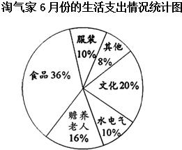

# Mathematics (Grade 6)

**ID**: a134dca0
**难度**: medium_hard
**题型**: short_answer

## 题目
观察统计图，回答问题：
（1）淘气家6月份的食品支出1080元，6月份的生活支出共多少元？
（2）文化支出多少元？其中文化支出的40%用于购买图书，购买图书多少元？

## 解答

**答案**: 3000, 600, 240

1. Step1:已知食品支出1080元，食品支出占6月份生活支出的36%，根据百分数除法的意义，用食品支出钱数除以食品支出所占百分率，即1080÷36%，可求出6月份生活支出共3000元
2. Step2:由上一步已求出6月份生活支出为3000元，文化支出占6月份生活支出的20%，根据百分数乘法的意义，用6月份生活支出乘文化支出所占百分率，即3000×20%，可求出文化支出为600元
3. Step3:已知文化支出为600元，文化支出的40%用于购买图书，根据百分数乘法的意义，用文化支出钱数乘购买图书所占百分率，即600×40%，可求出购买图书的钱数为240元

## 知识点

**知识点**:
  - 扇形统计图;从统计图表中获取信息

---
