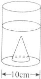

# Mathematics (Grade 6)

**ID**: a139a628
**难度**: medium_hard
**题型**: short_answer

## 题目
一个圆柱形玻璃容器里装有水，在水里浸没一个底面半径是3cm，高是10cm的圆锥铁块（如图），如果把铁块从圆柱形容器中取出，那么容器中的水面高度要下降多少厘米？

## 解答

**答案**: 1.2

1. Step1:根据圆锥体积公式v = $rac{1}{3}sh$，其中圆锥底面半径是3cm，高是10cm，先计算圆锥的底面积s = 3.14×3²，再计算圆锥体积v = $rac{1}{3}$×3.14×3²×10
2. Step2:计算圆柱形容器的底面半径，已知圆柱底面直径是10cm，则半径为10÷2 = 5cm，进而计算圆柱的底面积为3.14×（10÷2）²
3. Step3:用圆锥体积除以圆柱底面积，即$rac{1}{3}×3.14×3^{2}×10÷$[3.14×（10÷2）$^{2}$]，得到水面下降的高度

## 知识点

**知识点**:
  - 圆柱的侧面积、表面积和体积;圆锥的体积

---
