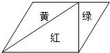

# Mathematics (Grade 6)

**ID**: a5b3079c
**难度**: medium_hard
**题型**: short_answer

## 题目

(2007•淮安模拟)一块平行四边形花坛分成三块不同的区域(如图)，黄色面积占整个面积的35%，绿色面积是27平方米，求这个花坛的总面积是多少平方米？

## 解答

**答案**: 180

1. Step1:根据图形可知，红色面积是平行四边形面积的一半，即 50%
2. Step2:已知黄色面积占整个面积的 35%，绿色面积占比为 1 - 35% - 50%
3. Step3:计算得出绿色面积占比为 15%
4. Step4:已知绿色面积是 27 平方米，根据已知一个数的百分之几是多少，求这个数用除法，所以总面积为 27÷15%
5. Step5:计算 27÷15%，先将 15%化为 0.15，即 27÷0.15 = 180 平方米

## 知识点

**知识点**:
  - 平行四边形的面积;百分数的实际应用．

---
