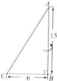

# Mathematics (Grade 6)

**ID**: a631e8c8
**难度**: medium_hard
**题型**: short_answer

## 题目
把三角形ABC以AB为轴旋转一周得到一个立体图形，计算如图所示立体图形的体积．（单位：cm）

## 解答

**答案**: 565.2

1. Step1:明确该立体图形为圆锥，其底面半径 r = 6cm，高 h = 15cm
2. Step2:根据圆锥体积公式 V$_{圆锥}$=$rac{1}{3}$πr$^{2}$h，将 r = 6、h = 15、π = 3.14 代入，得到$rac{1}{3}$×3.14×6$^{2}$×15
3. Step3:先计算 6$^{2}$=36，式子变为$rac{1}{3}$×3.14×36×15
4. Step4:计算$rac{1}{3}$×15 = 5，式子变为 3.14×36×5
5. Step5:计算 3.14×36×5 = 565.2 立方厘米

## 知识点

**知识点**:
  - 圆锥的体积．

---
