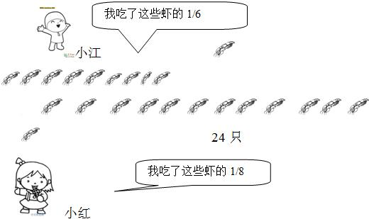

# Mathematics (Grade 6)

**ID**: a6c0981a
**难度**: medium_hard
**题型**: short_answer

## 题目
吃虾比赛，他俩谁吃的多？多多少只？

## 解答

**答案**: 小江, 1

1. Step1:根据解析2，把虾的总个数24看成单位“1”，用24乘\(rac{1}{6}\)，即24×\(rac{1}{6}\)=4只，得到小江吃虾的个数
2. Step2:同样根据解析2，用24乘\(rac{1}{8}\)，即24×\(rac{1}{8}\)=3只，得到小红吃虾的个数
3. Step3:比较小江和小红吃虾的个数，4＞3，可知小江吃的多
4. Step4:用小江吃虾的个数减去小红吃虾的个数，4 - 3 = 1只，得到小江比小红多吃的个数

## 知识点

**知识点**:
  - 分数大小的比较

---
