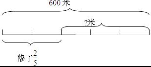

# Mathematics (Grade 6)

**ID**: a7125700
**难度**: medium_hard
**题型**: short_answer

## 题目
列式计算
①15的$\frac{2}{3}$比一个数的4倍少12，求这个数．
②看图列式计算．

## 解答

**答案**: 5.5, 360

1. Step1:计算15的$rac{2}{3}$，即15×$rac{2}{3}$=10
2. Step2:将上一步结果加上12，10 + 12 = 22，此为所求数的4倍
3. Step3:用22除以4，22÷4 = 5.5，得到这个数
4. Step4:计算1 - $rac{2}{5}$ = $rac{3}{5}$，得到要求长度占600米的分率
5. Step5:用600乘上$rac{3}{5}$，600×$rac{3}{5}$ = 360，得到所求长度

## 知识点

**知识点**:
  - 分数的四则混合运算;图文应用题

---
