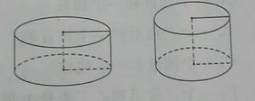

# Mathematics (Grade 6)

**ID**: a8389754
**难度**: medium_hard
**题型**: short_answer

## 题目
如图，将一个长为4cm，宽为3cm的长方形，分别绕它的长，宽所在的直线旋转一周，得到不同的圆柱体，它们的体积分别是多少？
 $(V_{圆柱}=πr^{2}d)$

## 解答

**答案**: 36πcm^{2}, 48πcm^{2}

1. Step1:明确绕长所在直线旋转时，长方形的宽为底面半径，长为高。根据圆柱体积公式V = πr²d，此时r = 3cm，d = 4cm，所以体积为π×3²×4 = 36πcm³
2. Step2:明确绕宽所在直线旋转时，长方形的长为底面半径，宽为高。根据圆柱体积公式V = πr²d，此时r = 4cm，d = 3cm，所以体积为π×4²×3 = 48πcm³

## 知识点

**知识点**:
  - --

---
