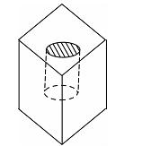

# Mathematics (Grade 6)

**ID**: a838a1b5
**难度**: medium_hard
**题型**: short_answer

## 题目
如图，从一个棱长是10分米的正方体中，挖去一个直径是4分米的圆柱，求剩下图形的体积是多少？

## 解答

**答案**: 874.4

1. Step1:根据圆柱直径4分米，计算其半径，4÷2 = 2分米
2. Step2:根据正方体体积计算公式，计算正方体体积，10×10×10 = 1000立方分米
3. Step3:根据圆柱体积计算公式，计算圆柱体积，3.14×2²×10 = 125.6立方分米
4. Step4:根据剩下图形的体积=正方体的体积-圆柱的体积，计算剩下图形体积，1000 - 125.6 = 874.4立方分米

## 知识点

**知识点**:
  - 长、正方体体积的计算;圆柱的体积

---
