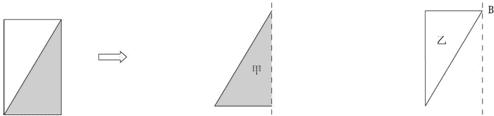

# Mathematics (Grade 6)

**ID**: ac6bb01f
**难度**: medium_hard
**题型**: short_answer

## 题目
(2014•尤溪县模拟)如图把一张长10厘米、宽6厘米的长方形纸板分成两个相等的直角三角形．绕乙三角形的顶点B所在的直线旋转一周，请你求出所形成的几何体的体积．

## 解答

**答案**: 753.6

1. Step1:明确所形成的几何体的体积计算方法，即等于底面半径是6厘米高是10厘米的圆柱体积减去底面半径是6厘米高是10厘米的圆锥体积
2. Step2:根据圆柱体积公式V1 = πr²h，其中r = 6厘米，h = 10厘米，计算圆柱体积V1 = 3.14×6²×10 = 3.14×360
3. Step3:根据圆锥体积公式V2 = 1/3πr²h，其中r = 6厘米，h = 10厘米，计算圆锥体积V2 = 1/3×3.14×6²×10 = 3.14×120
4. Step4:计算所形成几何体的体积V = V1 - V2 = 3.14×360 - 3.14×120 = 3.14×(360 - 120) = 3.14×240 = 753.6立方厘米

## 知识点

**知识点**:
  - 圆锥的体积;将简单图形平移或旋转一定的度数．

---
