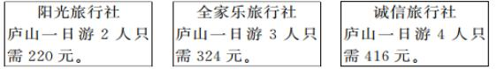

# Mathematics (Grade 6)

**ID**: ae4fadb8
**难度**: medium_hard
**题型**: short_answer

## 题目
五一到了，王芳从报纸上收集到几条关于庐山一日游的信息。

如果王芳想选择人均价格最便宜的旅行社，应该选哪一家？

## 解答

**答案**: 应该选择诚信旅行社。

1. Step1:根据总钱数÷出游人数=人均价格，计算阳光旅行社的人均价格，220÷2=110（元）
2. Step2:根据总钱数÷出游人数=人均价格，计算全家乐旅行社的人均价格，324÷3=108（元）
3. Step3:根据总钱数÷出游人数=人均价格，计算诚信旅行社的人均价格，416÷4=104（元）
4. Step4:比较三个旅行社的人均价格，104＜108＜110
5. Step5:得出结论，应该选择人均价格最低的诚信旅行社

## 知识点

**知识点**:
  - 整数复合应用题;整数大小的比较;平均数、中位数、众数的意义及求法

---
