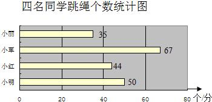

# Mathematics (Grade 6)

**ID**: b00fb7f9
**难度**: medium_hard
**题型**: short_answer

## 题目
看统计图回答问题．

(1)谁跳的个数最多？谁跳的次个最少？
(2)从图中你还能知道什么？

## 解答

**答案**: 小军, 小丽, 小明跳的个数比小红跳的个数多

1. Step1:观察条形统计图中代表小丽、小军、小红、小明跳绳个数的条形长度和对应数值，分别为小丽35个，小军67个，小红44个，小明50个
2. Step2:比较四人跳绳个数的大小，35＜44＜50＜67，得出小军跳的个数最多，小丽跳的个数最少
3. Step3:再次观察统计图，发现小明跳的个数50个大于小红跳的个数44个，得出小明跳的个数比小红跳的个数多

## 知识点

**知识点**:
  - 以一当五(或以上)的条形统计图;从统计图表中获取信息．

---
