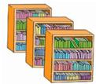

# Mathematics (Grade 6)

**ID**: b0b5d982
**难度**: medium_hard
**题型**: short_answer

## 题目
学校图书室里的书架每个有4层，每层大约可以放20本书．
（1）3个这样的书架，大约一共有多少本书？
（2）新买来550本书，增加几个这样的书架比较合适？

## 解答

**答案**: 240, 7

1. Step1:先计算每个书架可放书的数量，每层大约放20本书，每个书架有4层，所以每个书架可放书20×4 = 80本
2. Step2:再计算3个书架大约一共可放书的数量，每个书架可放80本，3个书架可放80×3 = 240本
3. Step3:接着计算每个书架可放书80本，新买来550本书，计算需要书架的数量，550÷80 = 6.875个
4. Step4:由于书架个数必须为整数，对6.875向上取整得到7个

## 知识点

**知识点**:
  - 整数的乘法及应用

---
