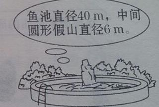

# Mathematics (Grade 6)

**ID**: b0ed79f7
**难度**: medium_hard
**题型**: short_answer

## 题目
刘叔叔承包了一个圆形养鱼池.
 (1)刘叔叔绕着养鱼池走一圈，走了多少米？

 鱼池直径40m，中间圆形假山直径6m.
 (2)养鱼池的水面面积是多少平方米？

## 解答

**答案**: 125.6, 2483.74

1. Step1:求刘叔叔绕养鱼池走一圈的路程，即求养鱼池的周长，根据圆的周长公式C = πd（d为直径），这里鱼池直径40m，所以周长为40×3.14 = 125.6米
2. Step2:求养鱼池的水面面积，养鱼池的水面面积等于鱼池的面积减去中间圆形假山的面积，根据圆的面积公式S = πr²（r为半径），鱼池半径为40÷2 = 20m，其面积为20²×3.14 = 1256平方米，假山半径为6÷2 = 3m，其面积为3²×3.14 = 28.26平方米，所以养鱼池水面面积为1256×2 - 28.26 = 2483.74平方米

## 知识点

**知识点**:
  - --

---
