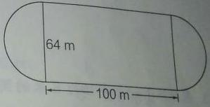

# Mathematics (Grade 6)

**ID**: b10fb26f
**难度**: medium_hard
**题型**: short_answer

## 题目
爸爸围着运动场跑步，跑一圈是多少米？这个运动场占地面积是多大？

 64m  100m

## 解答

**答案**: 400.96, 9615.36

1. Step1:分析运动场跑一圈的长度构成，可知是由长方形两边的长和一个圆的周长组成，长方形长为100米，两边长为100 + 100，圆的直径为64米，根据圆的周长公式C = πd（π取3.14），圆的周长为3.14×64，所以跑一圈长度为3.14×64 + 100 + 100 = 200.96 + 200 = 400.96米
2. Step2:分析运动场占地面积构成，可知是由长方形的面积和一个圆的面积组成，长方形长100米，宽64米，根据长方形面积公式S = a×b，长方形面积为64×100，圆的直径为64米，半径为64÷2，根据圆的面积公式S = πr²（π取3.14），圆的面积为3.14×(64÷2)²，所以运动场占地面积为3.14×(64÷2)² + 64×100 = 3215.36 + 6400 = 9615.36平方米

## 知识点

**知识点**:
  - --

---
