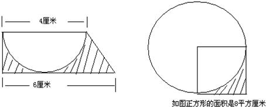

# Mathematics (Grade 6)

**ID**: b547007a
**难度**: medium_hard
**题型**: short_answer

## 题目
计算图中阴影部分的面积

## 解答

**答案**: 3.72, 1.72

1. Step1:计算左边图形阴影部分面积，先求梯形面积，梯形的上底为4厘米，下底为6厘米，高为4÷2 = 2厘米，根据梯形面积公式S=(a + b)h÷2，可得梯形面积为(4 + 6)×(4÷2)÷2 = 10平方厘米
2. Step2:计算左边图形中半圆的面积，半径为4÷2 = 2厘米，根据圆的面积公式S = πr²，半圆面积为3.14×(4÷2)²÷2 = 6.28平方厘米
3. Step3:计算左边图形阴影部分面积，用梯形面积减去半圆面积，即10 - 6.28 = 3.72平方厘米
4. Step4:计算右边图形阴影部分面积，设圆的半径为r，已知正方形面积为8平方厘米，且正方形边长等于圆的半径，所以r² = 8
5. Step5:计算右边图形中1/4圆的面积，根据圆的面积公式S = πr²，1/4圆面积为1/4×3.14×8 = 6.28平方厘米
6. Step6:计算右边图形阴影部分面积，用正方形面积减去1/4圆的面积，即8 - 6.28 = 1.72平方厘米

## 知识点

**知识点**:
  - 组合图形的面积．

---
