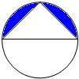

# Mathematics (Grade 6)

**ID**: b5fdce54
**难度**: medium_hard
**题型**: short_answer

## 题目
求阴影部分的面积．(直径8分米)

## 解答

**答案**: 9.12

1. Step1:根据圆的直径为8分米，计算圆的半径，8÷2 = 4分米
2. Step2:计算半圆的面积，根据圆的面积公式S = πr²，半圆面积为3.14×4²÷2 = 3.14×16÷2 = 25.12平方分米
3. Step3:计算等腰直角三角形的面积，底为8分米，高为8÷2 = 4分米，根据三角形面积公式S = 底×高÷2，其面积为8×4÷2 = 16平方分米
4. Step4:计算阴影部分面积，用半圆面积减去等腰直角三角形面积，25.12 - 16 = 9.12平方分米

## 知识点

**知识点**:
  - 组合图形的面积．

---
