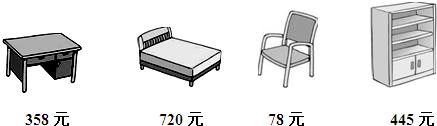

# Mathematics (Grade 6)

**ID**: b7065eb6
**难度**: medium_hard
**题型**: short_answer

## 题目
看图回答

（1）买一个书柜比买一张床少花多少钱？
（2）买一套桌椅要花多少钱？
（3）你还能提出不同的数学问题吗？并尝试解答．

## 解答

**答案**: 275, 446, 362

1. Step1:明确图中物品价格，桌子358元，床720元，椅子78元，书柜445元
2. Step2:计算买一个书柜比买一张床少花的钱，720 - 445 = 275
3. Step3:计算买一套桌椅要花的钱，358 + 78 = 446
4. Step4:提出问题“买一张床比一张桌子多花多少钱”并计算，720 - 358 = 362

## 知识点

**知识点**:
  - “提问题”、“填条件”应用题;整数的加法和减法

---
