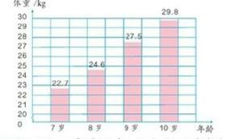

# Mathematics (Grade 6)

**ID**: b8bad2cf
**难度**: medium_hard
**题型**: short_answer

## 题目
下面是小明的体重统计图。

 （1）小明从7岁到10岁，体重增加了多少千克？
 （2）哪一年比上一年增加得最多？增加了多少？

## 解答

**答案**: 7.1, 9岁, 2.9

1. Step1:从统计图中可知小明7岁体重是22.7千克，10岁体重是29.8千克，用10岁体重29.8千克减去7岁体重22.7千克，即29.8 - 22.7 = 7.1千克，得到从7岁到10岁体重增加量
2. Step2:计算8岁比7岁增加的体重，8岁体重24.6千克减去7岁体重22.7千克，即24.6 - 22.7 = 1.9千克
3. Step3:计算9岁比8岁增加的体重，9岁体重27.5千克减去8岁体重24.6千克，即27.5 - 24.6 = 2.9千克
4. Step4:计算10岁比9岁增加的体重，10岁体重29.8千克减去9岁体重27.5千克，即29.8 - 27.5 = 2.3千克
5. Step5:比较1.9千克、2.9千克、2.3千克的大小，得出2.9千克最大，所以9岁比8岁增加得最多，增加量为2.9千克

## 知识点

**知识点**:
  - 小数的加法和减法;小数加减法

---
