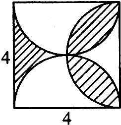

# Mathematics (Grade 6)

**ID**: b9a44176
**难度**: medium_hard
**题型**: short_answer

## 题目
求图中阴影部分的面积．（单位：cm）

## 解答

**答案**: 6.28

1. Step1:根据解析2可知，图中形似三角形的阴影部分与形似三角形的空白部分面积相等，所以阴影部分面积等于以4厘米为直径的半圆的面积。
2. Step2:根据圆的面积公式S = πr²（其中r为半径），先计算半径，r = 4÷2 = 2厘米。
3. Step3:再计算半圆的面积，半圆面积 = 3.14×2²÷2 = 3.14×4÷2 = 6.28平方厘米。

## 知识点

**知识点**:
  - 组合图形的面积．

---
