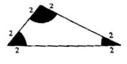

# Mathematics (Grade 6)

**ID**: bc4d5193
**难度**: medium_hard
**题型**: short_answer

## 题目
如图，任意三角形，求阴影部分的周长和面积（单位：cm）

## 解答

**答案**: 18.24, 6.24

1. Step1:根据三角形内角和为180°，确定阴影部分合起来是一个半圆
2. Step2:计算阴影部分周长，先求半径为2厘米的圆周长的一半，即2×2×3.14÷2，再计算6条2厘米线段的长度和为2×6，最后将两部分相加得到2×2×3.14÷2 + 2×6 = 6.28 + 12 = 18.28厘米
3. Step3:计算阴影部分面积，求半径为2厘米的圆面积的一半，即2×2×3.14÷2 = 6.28平方厘米
4. Step4:将周长18.28和面积6.28整理成列表['18.28', '6.28']

## 知识点

**知识点**:
  - --

---
