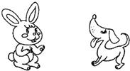

# Mathematics (Grade 6)

**ID**: bf59f760
**难度**: medium_hard
**题型**: short_answer

## 题目
小狗和小兔赛跑，当小狗跑了全程的$\frac{7}{12}$时，小兔跑了全程的$\frac{5}{12}$，它们俩谁跑得快？快几分之几？

## 解答

**答案**: 小狗跑的快, 快全程的$\frac{1}{6}$

1. Step1:明确在相同时间内，比较小狗和小兔跑的路程占全程的比例大小，路程占比大的跑得快，小狗跑了全程的$rac{7}{12}$，小兔跑了全程的$rac{5}{12}$，因为$rac{7}{12}$＞$rac{5}{12}$，所以得出小狗跑得快
2. Step2:计算小狗比小兔快的部分，用小狗跑的路程占比减去小兔跑的路程占比，即$rac{7}{12}$ - $rac{5}{12}$ = $rac{2}{12}$，约分后得到$rac{1}{6}$，所以得出小狗比小兔快全程的$rac{1}{6}$

## 知识点

**知识点**:
  - 分数大小的比较；分数加减法应用题．

---
