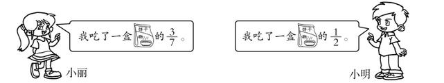

# Mathematics (Grade 6)

**ID**: c08a3fa6
**难度**: medium_hard
**题型**: short_answer

## 题目
谁吃得多？

## 解答

**答案**: 小明

1. Step1:找出\(rac{3}{7}\)和\(rac{1}{2}\)分母7和2的最小公倍数为14
2. Step2:将\(rac{3}{7}\)通分，分子分母同乘2得到\(rac{3	imes2}{7	imes2}=rac{6}{14}\)
3. Step3:将\(rac{1}{2}\)通分，分子分母同乘7得到\(rac{1	imes7}{2	imes7}=rac{7}{14}\)
4. Step4:比较\(rac{7}{14}\)和\(rac{6}{14}\)的大小，因为\(rac{7}{14}\gtrac{6}{14}\)，所以\(rac{1}{2}\gtrac{3}{7}\)
5. Step5:因为\(rac{1}{2}\)是小明吃的占比，\(rac{3}{7}\)是小丽吃的占比，且\(rac{1}{2}\gtrac{3}{7}\)，所以小明吃得多

## 知识点

**知识点**:
  - 异分母分数的大小比较

---
