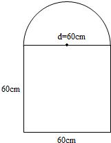

# Mathematics (Grade 6)

**ID**: c11238c4
**难度**: medium_hard
**题型**: short_answer

## 题目
(2012•承德模拟)计算如图的周长和面积．

## 解答

**答案**: 274.2, 5013

1. Step1:根据解析2可知，先求圆周长的一半，圆的直径为60厘米，根据圆的周长公式C = πd（d为直径），则圆周长的一半为3.14×60÷2
2. Step2:求正方形的3条边长之和，正方形边长为60厘米，所以3条边长之和为60×3
3. Step3:将圆周长的一半与正方形3条边长之和相加，得到组合图形的周长，即3.14×60÷2 + 60×3 = 94.2 + 180 = 274.2厘米
4. Step4:根据解析2可知，求半圆的面积，圆的直径为60厘米，半径为60÷2厘米，根据圆的面积公式S = πr²（r为半径），则半圆面积为3.14×(60÷2)²÷2
5. Step5:求正方形的面积，正方形边长为60厘米，面积为60×60平方厘米
6. Step6:将半圆面积与正方形面积相加，得到组合图形的面积，即3.14×(60÷2)²÷2 + 60×60 = 1413 + 3600 = 5013平方厘米

## 知识点

**知识点**:
  - 组合图形的面积;正方形的周长;圆、圆环的周长;长方形、正方形的面积;圆、圆环的面积．

---
