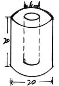

# Mathematics (Grade 6)

**ID**: c129c52b
**难度**: medium_hard
**题型**: short_answer

## 题目
求图形的体积

## 解答

**答案**: 5714.8

1. Step1:明确图形为空心圆柱，根据圆环面积公式求底面积，圆环面积公式为S = 3.14×(R² - r²)，其中R为外圆半径，r为内圆半径，由图可知外圆直径为20，则外圆半径R = 20÷2 = 10，内圆直径为6，则内圆半径r = 6÷2 = 3，所以底面积S = 3.14×(10² - 3²) = 3.14×(100 - 9) = 3.14×91
2. Step2:已知圆柱的高为20，根据圆柱体积公式V = Sh（S为底面积，h为高），可得体积V = 3.14×91×20 = 5714.8

## 知识点

**知识点**:
  - 组合图形的体积．

---
