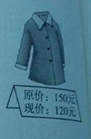

# Mathematics (Grade 6)

**ID**: c12d210f
**难度**: medium_hard
**题型**: short_answer

## 题目
（1）这件衣服原价比现价贵百分之几？
 （2）现价比原价便宜百分之几？

 150元；120元

## 解答

**答案**: $\frac{1}{4}$, $\frac{1}{5}$

1. Step1:计算原价比现价贵的金额，150 - 120 = 30元
2. Step2:计算原价比现价贵的百分比，用贵的金额除以现价，即30÷120 = $\frac{1}{4}$
3. Step3:再次计算原价比现价贵的金额，150 - 120 = 30元
4. Step4:计算现价比原价便宜的百分比，用便宜的金额除以原价，即30÷150 = $\frac{1}{5}$

## 知识点

**知识点**:
  - --

---
