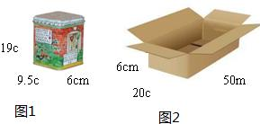

# Mathematics (Grade 6)

**ID**: c2132614
**难度**: medium_hard
**题型**: short_answer

## 题目
如图，把6个如图1所示的饼干盒装入图2这个纸箱，能装下吗？

## 解答

**答案**: 不能装下

1. Step1:根据长方体体积公式V = a×b×h，其中a = 6厘米，b = 20厘米，h = 50厘米，计算纸箱体积为6×20×50 = 120×50 = 6000立方厘米
2. Step2:计算一个饼干盒体积，根据长方体体积公式V = a×b×h，其中a = 9.5厘米，b = 6厘米，h = 19厘米，得到一个饼干盒体积为9.5×6×19立方厘米
3. Step3:计算6个饼干盒体积，为6×9.5×6×19 = 57×19×6 = 6498立方厘米
4. Step4:比较纸箱体积和6个饼干盒体积大小，因为6000＜6498，即纸箱的容积＜6个饼干盒的体积，所以得出不能装下的结论

## 知识点

**知识点**:
  - 长方体和正方体的体积

---
