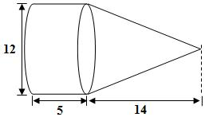

# Mathematics (Grade 6)

**ID**: c2c36ab3
**难度**: medium_hard
**题型**: short_answer

## 题目
求下面图形的体积（单位：cm）

## 解答

**答案**: 1092.72

1. Step1:先计算圆柱底面半径，由直径12cm可得半径为12÷2 = 6cm
2. Step2:计算圆柱体积，根据圆柱体积公式V = πr²h，其中π取3.14，r = 6cm，h = 5cm，即3.14×6²×5 = 3.14×36×5 = 565.2cm³
3. Step3:计算圆锥体积，根据圆锥体积公式V = 1/3πr²h，其中π取3.14，r = 6cm，h = 14cm，即1/3×3.14×6²×14 = 3.14×12×14 = 527.52cm³
4. Step4:将圆柱体积与圆锥体积相加得到图形体积，565.2 + 527.52 = 1092.72cm³

## 知识点

**知识点**:
  - 组合图形的体积

---
