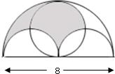

# Mathematics (Grade 6)

**ID**: c40ce0b5
**难度**: medium_hard
**题型**: short_answer

## 题目
求阴影部分面积．

## 解答

**答案**: 10.28

1. Step1:计算大扇形的半径，由8÷2=4可得大扇形半径为4
2. Step2:计算小扇形及正方形的边长，8÷2÷2=2，所以边长为2
3. Step3:计算半径为4的1/4圆的面积，即1/4×3.14×4²=12.56
4. Step4:计算半径为2的2个1/4圆的面积，即1/4×3.14×2²×2=6.28
5. Step5:计算边长为2的正方形的面积，2×2=4
6. Step6:计算③的面积，用半径为2的2个1/4圆的面积减去正方形的面积，6.28 - 4=2.28
7. Step7:计算阴影部分面积，用半径为4的1/4圆的面积减去③的面积，12.56 - 2.28=10.28

## 知识点

**知识点**:
  - 组合图形的面积．

---
