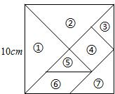

# Mathematics (Grade 6)

**ID**: c6bcd215
**难度**: medium_hard
**题型**: short_answer

## 题目
如图，用边长为10cm的正方形木板制作了一副七巧板，求各部分图形的面积．

## 解答

**答案**: 25, $\frac{25}{4}$, $\frac{25}{2}$

1. Step1:计算正方形木板的面积，根据正方形面积公式S=a²（a为边长），可得10×10 = 100平方厘米
2. Step2:因为①和②面积都占整个正方形面积的1/4，所以①和②的面积为100×1/4 = 25平方厘米
3. Step3:由于③和⑤面积占整个正方形面积的1/16，因此③和⑤的面积为100×1/16 = 25/4平方厘米
4. Step4:又因为④、⑥、⑦的面积都占正方形面积的1/8，所以④、⑥、⑦的面积为100×1/8 = 25/2平方厘米

## 知识点

**知识点**:
  - 长方形、正方形的面积;分数乘法应用题

---
