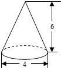

# Mathematics (Grade 6)

**ID**: c763c1bb
**难度**: medium_hard
**题型**: short_answer

## 题目
(2007•长汀县)计算下图的体积(单位：厘米)．

## 解答

**答案**: 25.12

1. Step1:根据图形可知圆锥的高为6厘米
2. Step2:根据图形可知圆锥底面直径为4厘米
3. Step3:计算圆锥底面半径，4÷2 = 2厘米
4. Step4:根据圆的面积公式S = πr²，计算圆锥底面积，3.14×2² = 3.14×4
5. Step5:根据圆锥体积公式V = 1/3×S×h，其中S为底面积，h为高，列出算式1/3×3.14×4×6
6. Step6:计算1/3×3.14×4×6的结果，1/3×3.14×4×6 = 25.12立方厘米
7. Step7:得出圆锥体积为25.12立方厘米

## 知识点

**知识点**:
  - 圆锥的体积．

---
