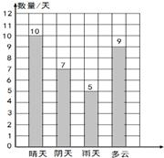

# Mathematics (Grade 6)

**ID**: c7ccd4aa
**难度**: medium_hard
**题型**: short_answer

## 题目
下面是某市一个月天气变化情况统计图．
（1）阴天的天数是晴天的几分之几？
（2）多云的天数是这个月总天数的几分之几？

## 解答

**答案**: $\frac{7}{10}$, $\frac{9}{31}$

1. Step1:观察统计图可知晴天有10天，阴天有7天，根据求一个数是另一个数的几分之几用除法，计算阴天的天数是晴天的几分之几，即7÷10=$\frac{7}{10}$
2. Step2:观察统计图可知晴天有10天，阴天有7天，雨天有5天，多云有9天，先计算这个月总天数为10 + 7 + 5 + 9 = 31天
3. Step3:根据求一个数是另一个数的几分之几用除法，计算多云的天数是这个月总天数的几分之几，即9÷31=$\frac{9}{31}$

## 知识点

**知识点**:
  - 分数除法应用题;以一当二的条形统计图

---
