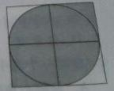

# Mathematics (Grade 6)

**ID**: c851f2bc
**难度**: medium_hard
**题型**: short_answer

## 题目
如果大正方形的边长为8cm，求阴影部分的周长和面积．

## 解答

**答案**: 28.56, 57.12

1. Step1:根据解析2可知，先求圆的周长，圆的直径等于大正方形的边长8cm，根据圆的周长公式C = πd（d为直径），可得圆的周长为3.14×8cm。
2. Step2:计算圆周长的1/4再乘以2，即3.14×8×1/4×2 = 12.56cm。
3. Step3:计算正方形边长的1/2，8×1/2 = 4cm。
4. Step4:计算正方形边长的1/2再乘以4，即4×4 = 16cm。
5. Step5:将圆周长的1/4乘以2的结果与正方形边长的1/2乘以4的结果相加，得到阴影部分周长为12.56 + 16 = 28.56cm。
6. Step6:计算大正方形的面积，根据正方形面积公式S = a²（a为边长），可得大正方形面积为8×8 = 64cm²。
7. Step7:计算大正方形面积的一半，即64×1/2 = 32cm²。
8. Step8:计算圆的半径，r = 8÷2 = 4cm。
9. Step9:根据圆的面积公式S = πr²，可得圆的面积为3.14×4² = 50.24cm²。
10. Step10:计算半圆的面积，即50.24×1/2 = 25.12cm²。
11. Step11:将半圆的面积与正方形面积的一半相加，得到阴影部分面积为32 + 25.12 = 57.12cm²。
12. Step12:整理结果，得到阴影部分周长为28.56cm，面积为57.12cm²，提取数值为['28.56', '57.12']

## 知识点

**知识点**:
  - --

---
