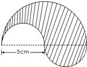

# Mathematics (Grade 6)

**ID**: c866e2e8
**难度**: medium_hard
**题型**: short_answer

## 题目
求如图的周长(π取3.14)

## 解答

**答案**: 31.4(cm)

1. Step1:明确图形周长的组成，是半径为5cm的半圆的弧长加上直径为5cm的圆的周长
2. Step2:根据圆的周长公式C = 2πr（r为半径）和半圆弧长公式l = πr（r为半径），半径为5cm的半圆的弧长为3.14×5×2÷2
3. Step3:直径为5cm的圆的半径为5÷2 = 2.5cm，其周长为3.14×5
4. Step4:将半圆的弧长与圆的周长相加，即3.14×5×2÷2 + 3.14×5
5. Step5:计算3.14×5×2÷2 + 3.14×5 = 15.7 + 15.7 = 31.4(cm)

## 知识点

**知识点**:
  - 组合图形的面积．

---
