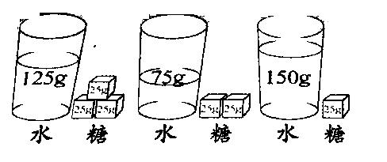

# Mathematics (Grade 6)

**ID**: c958e242
**难度**: medium_hard
**题型**: short_answer

## 题目

糖水的浓度=$\frac{糖}{糖+水}$×100%
哪杯糖水最甜？

## 解答

**答案**: 40%

1. Step1:计算第一杯糖水浓度，糖的质量为25×3 = 75g，糖水质量为125 + 25×3 = 200g，浓度为(25×3)÷(125 + 25×3)×100% = 37.5%
2. Step2:计算第二杯糖水浓度，糖的质量为25×2 = 50g，糖水质量为75 + 25×2 = 125g，浓度为(25×2)÷(75 + 25×2)×100% = 40%
3. Step3:计算第三杯糖水浓度，糖的质量为25g，糖水质量为150 + 25 = 175g，浓度为25÷(150 + 25)×100% ≈ 14%
4. Step4:比较三杯糖水浓度大小，14%＜37.5%＜40%
5. Step5:得出最甜的糖水浓度为40%

## 知识点

**知识点**:
  - 求一个数是另一个数的百分之几

---
