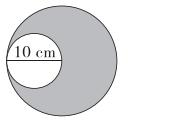

# Mathematics (Grade 6)

**ID**: c96406a4
**难度**: medium_hard
**题型**: short_answer

## 题目
下图中的大圆半径等干小圆的直径，请求出阴影部分面积。

## 解答

**答案**: 235.5

1. Step1:根据已知条件得出大圆半径为10cm，小圆半径为10÷2 = 5cm
2. Step2:根据圆的面积公式S = πr²，可得大圆面积为3.14×10² = 314cm²
3. Step3:根据圆的面积公式可得小圆面积为3.14×(10÷2)² = 78.5cm²
4. Step4:因为阴影部分面积等于大圆面积减去小圆面积，所以阴影部分面积为314 - 78.5 = 235.5cm²
5. Step5:将阴影部分面积的值以列表形式呈现，即['235.5']

## 知识点

**知识点**:
  - 圆的面积;组合图形的面积

---
