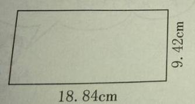

# Mathematics (Grade 6)

**ID**: ca9fb7b5
**难度**: medium_hard
**题型**: short_answer

## 题目
用下面的长方形纸围城一个圆柱，你有几种围法？围成的圆柱的底面半径分别是多少厘米？

 18.84cm
 9.42cm

## 解答

**答案**: 3, 1.5

1. Step1:明确围法有两种，分别是将长方形的长作为圆柱底面周长和将长方形的宽作为圆柱底面周长
2. Step2:当把长18.84cm作为底面周长时，根据圆的周长公式C = 2πr（C为周长，r为半径），可得底面半径r = 18.84÷3.14÷2 = 3厘米
3. Step3:当把宽9.42cm作为底面周长时，根据圆的周长公式C = 2πr，可得底面半径r = 9.42÷3.14÷2 = 1.5厘米

## 知识点

**知识点**:
  - --

---
