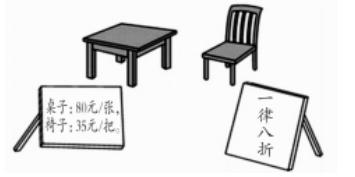

# Mathematics (Grade 6)

**ID**: cb5409e5
**难度**: medium_hard
**题型**: short_answer

## 题目
1张桌子配1把椅子为1套桌椅，购买10套要多少钱？

## 解答

**答案**: 920

1. Step1:计算一张桌子和一把椅子的原价总和，即80 + 35 = 115元
2. Step2:根据分数乘法的意义，计算一套桌椅打八折后的价格，即115×$\frac{8}{10}$ = 92元
3. Step3:计算购买10套桌椅的总价，即92×10 = 920元

## 知识点

**知识点**:
  - 分数乘法应用题

---
