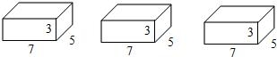

# Mathematics (Grade 6)

**ID**: ce3527cb
**难度**: medium_hard
**题型**: short_answer

## 题目
如图：（单位：分米）小红要包装上面的礼品，怎样包装最省纸？为什么？

## 解答

**答案**: 286

1. Step1:分析可知要想最省纸，需让拼接时表面积减少最多，长方体中不同面的面积分别为7×5、7×3、5×3，比较可得7×5的面面积最大，所以把面积最大的面重合一起最省纸
2. Step2:把三个礼品面积最大的面重合，拼成一个长为7分米，宽为5分米，高为3×3 = 9分米的长方体
3. Step3:根据长方体表面积公式S=(ab+ah+bh)×2（其中a为长，b为宽，h为高），计算该长方体表面积为（7×5+7×9+5×9）×2 =（35+63+45）×2 = 143×2 = 286平方分米

## 知识点

**知识点**:
  - 简单的立方体切拼问题；长方体和正方体的表面积．

---
