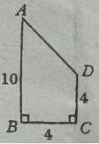

# Mathematics (Grade 6)

**ID**: ced3c266
**难度**: medium_hard
**题型**: short_answer

## 题目
如图，四边形ABCD是直角梯形。以AB为轴将梯形旋转一周后，得到一个旋转体，它的体积是多少？（单位：cm）

 10  4  4

## 解答

**答案**: 301.44

1. Step1:根据解析2可知，旋转后下半部分是圆柱，其底面半径r = 4厘米，高h1 = 4厘米，根据圆柱体积公式V1 = πr²h1，可得V1 = 3.14×4²×4 = 3.14×16×4
2. Step2:根据解析2可知，旋转后上半部分是圆锥，其底面半径r = 4厘米，高h2 = 10 - 4 = 6厘米，根据圆锥体积公式V2 = 1/3×πr²h2，可得V2 = 1/3×3.14×4²×6 = 3.14×16×6÷3
3. Step3:旋转体体积V = V1 + V2，即V = 3.14×16×4 + 3.14×16×6÷3 = 3.14×64 + 3.14×32 = 301.44（立方厘米）

## 知识点

**知识点**:
  - 

---
